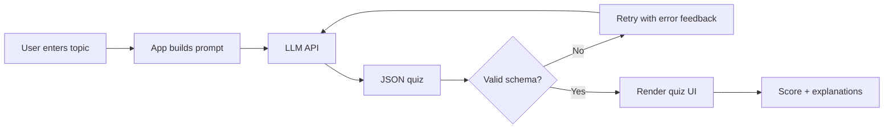

# Employee Quiz Builder

An AI-powered tool that generates multiple-choice quizzes for property-industry employees from any topic, e.g. "Top skills of a property agent in 2025" or "Property Market updates in Jakarta".

Built for the 99 Group Section 2 (Tool/Workflow Building) assignment, Option C.

- **Live demo:** https://derrylpriyambodo24-employee-quiz-builder-app-teupmp.streamlit.app/
- **Repo:** https://github.com/derrylpriyambodo24/employee-quiz-builder/

## What it does

1. The user enters a topic, number of questions, and difficulty.
2. The app sends the topic to an LLM with a strict system prompt.
3. The LLM returns a quiz as JSON: question, 4 options, correct answer, short explanation.
4. The app validates the JSON, shows the quiz, scores the answers, and displays explanations.

## Architecture



## Tech stack

> Edit this section to match what you actually used.

- Language/framework: Python + Streamlit
- LLM: Groq free tier via its OpenAI-compatible API, model `openai/gpt-oss-120b` (configurable with `LLM_MODEL` / `LLM_BASE_URL`). Reason: <write your own reason>
- Optional: web search for topics that need up-to-date data

## Project structure

```
.
├── app.py                  # Streamlit UI
├── quiz_logic.py           # LLM call, JSON parsing/validation, shuffling, retry
├── check_llm.py            # diagnostic: checks .env, lists models, sends a test request
├── .streamlit/config.toml  # theme
├── tests/                  # offline tests (no API key needed)
├── prompts/
│   ├── system_prompt.txt   # system prompt for quiz generation
│   └── user_prompt.txt     # user prompt template
├── examples/
│   ├── quiz_property_agent_2025.json
│   └── quiz_jakarta_market.json
├── .env.example            # copy to .env and add your key
├── requirements.txt
└── README.md
```

## Setup

```bash
git clone <YOUR REPO URL>
cd <repo-folder>
pip install -r requirements.txt
cp .env.example .env        # then add your API key
# run the app (adjust to your stack):
streamlit run app.py
# run tests:
python -m pytest -q
```

`.env.example`:

```
LLM_API_KEY=your_api_key_here
LLM_BASE_URL=https://api.groq.com/openai/v1
LLM_MODEL=openai/gpt-oss-120b
```

Never commit your real `.env` file.

## Prompts

The full prompts are in [`prompts/`](./prompts). Summary:

- **System prompt:** instructs the model to act as a property-industry trainer, output **only valid JSON**, make exactly 4 options per question, vary the position of the correct answer, and include a one-sentence explanation.
- **User prompt:** `Create {n} {difficulty} multiple-choice questions about: {topic}`.

## Example outputs

See [`examples/`](./examples) for generated quizzes on:

- Top skills of a property agent in 2025
- Property Market updates in Jakarta

## Problems I ran into and how I fixed them

> Write this in your own words. Real details count more than a polished summary. Replace the examples below with what actually happened.

- **Broken JSON:** <e.g. the model wrapped output in markdown fences. Fix: strip fences + validate schema + retry once.>
- **Answer position bias:** <e.g. correct answer was often option A. Fix: prompt rule + shuffle options in code.>
- **Outdated facts:** <e.g. market data was old. Fix: added web search / added a disclaimer.>

## What I would improve with more time

- <e.g. export quiz to PDF or share link>
- <e.g. store quiz history and employee scores>
- <e.g. fact-check step that verifies each answer against sources>
